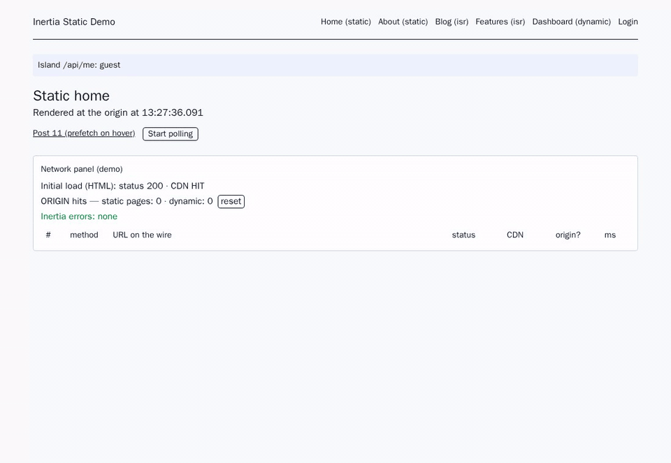

# Inertia Static

[](https://github.com/fydellys/inertia-static/actions/workflows/tests.yml)
[](https://packagist.org/packages/fydellys/inertia-static)
[](https://packagist.org/packages/fydellys/inertia-static)
[](https://packagist.org/packages/fydellys/inertia-static)


[](LICENSE)
[](https://fydellys.github.io/inertia-static/)

Inertia Static brings SSG/ISR to **Laravel + Inertia.js** without depending on a specific provider. Your pages are rendered at the origin, cached at the edge of any CDN, revalidated by time or on demand, and navigated as a normal Inertia SPA. No session ever reaches the cache.

It is based on the rendering model of [Next.js](https://nextjs.org/docs/app/guides/incremental-static-regeneration): the same SSG and ISR ideas, with the same names (`revalidate`, tags, on-demand revalidation, preview mode), applied to Laravel routes and served by your CDN. See [Compared to Next.js](https://fydellys.github.io/inertia-static/concepts/nextjs) for the mapping.

Works with Cloudflare, Fastly, Bunny, CloudFront, Varnish, nginx or any HTTP cache.



**Documentation:** https://fydellys.github.io/inertia-static/

## SSG and ISR in short

**SSG (Static Site Generation).** A page is rendered once and the same HTML is served to every visitor, from a cache, without running your controller again. It is fast and cheap, and it survives traffic spikes, because the origin is not involved.

**ISR (Incremental Static Regeneration).** SSG that updates itself, page by page, without a new deploy:

- **By time.** After `revalidate` seconds the cached page is stale. The next visitor still gets it instantly, and the page is rendered again in the background (stale-while-revalidate). The following visitors get the new version.
- **On demand.** When your data changes, purge the pages that use it (by tag, URL or prefix), for example when a post is saved. The next visit renders a fresh page.
- **Pages that do not exist yet** are rendered on their first visit and cached from then on.

| Request | CDN | What happens |
|---|---|---|
| 1st visit to `/blog/hello` | `MISS` | Laravel renders the page and the CDN caches it |
| Next visits | `HIT` | Served from the CDN, Laravel is not called |
| After `revalidate` seconds | `STALE` | The cached page is served at once and rendered again in the background |
| Post saved | | Tag `post:1` is purged; the next visit renders the page again |

Laravel stays in charge of everything dynamic: forms, sign in, and user data loaded in [islands](https://fydellys.github.io/inertia-static/guide/islands).

## Requirements

PHP 8.3+, Laravel 12 or 13, Inertia 2 or 3 (`inertiajs/inertia-laravel` ^2.0.16 or ^3.0), Vue 3.5+ or React 18+. Works with or without Inertia SSR.

## Installation

```bash
composer require fydellys/inertia-static
php artisan vendor:publish --tag=inertia-static-config
```

The client ships with the Composer package, so there is nothing to install from npm:

```js
// vite.config.js
import inertiaStatic from './vendor/fydellys/inertia-static/js/vite.js'

export default defineConfig({
  plugins: [laravel({ /* ... */ }), vue(), inertiaStatic()],
})
```

```ts
// resources/js/app.ts
import { inertiaStatic } from '@fydellys/inertia-static/vue'
import manifest from './inertia-static.json' // generated by the Vite plugin

createInertiaApp({
  http: inertiaStatic({ manifest }),
  // resolve, setup...
})
```

React: import from `@fydellys/inertia-static/react`. On Inertia 2, install it on axios instead:
`installInertiaStatic(axios, { manifest })` from `@fydellys/inertia-static/inertia2` (Vue) or
`@fydellys/inertia-static/inertia2/react`.

## Usage

Declare which routes are static:

```php
Route::get('/', HomeController::class)->static(revalidate: 600);

Route::get('/blog/{post:slug}', [PostController::class, 'show'])
    ->isr(revalidate: 3600, tags: ['posts'], paths: PostPaths::class);
```

Fine-tune the cache of each response, right in the controller:

```php
return Inertia::render('Post/Show', ['post' => $post])
    ->revalidate(3600)            // edge TTL for this response
    ->staleWhileRevalidate(86400) // serve the old page while it is rendered again
    ->staleIfError(604800)        // keep serving it if the origin fails
    ->tags(['posts', "post:{$post->id}"]);
```

Purge by tag when the data changes:

```php
class Post extends Model
{
    use HasStaticTags; // saved / deleted => purge ['posts', 'post:{id}']
}

StaticCache::purgeTags(['posts']);   // or purgeUrls(), purgePrefix(), purgeAll()
```

Only public shared props reach static pages. User data is loaded in the browser:

```php
// config/inertia-static.php
'public_shared_props' => ['appName'],
```

```vue
<script setup lang="ts">
const { data } = useStaticIsland<{ user: { name: string } | null }>('/api/me')
</script>
```

Pick a CDN driver:

```ini
INERTIA_STATIC_CDN=cloudflare
CLOUDFLARE_ZONE_ID=...
CLOUDFLARE_API_TOKEN=...   # optional: without it, pages are cached and expire by TTL only
```

Check the setup:

```bash
php artisan inertia-static:routes
php artisan inertia-static:doctor
```

The CDN also needs its own configuration. On Cloudflare, HTML is not cached until you add a Cache Rule. See [CDN setup](https://fydellys.github.io/inertia-static/cdn/overview).

## How it works

- **No session on static routes.** Cookies, the session, CSRF and private shared props are removed. A leak detector throws when code reads the user or the session during a static render.
- **Page JSON on its own URL** (`/__inertia/{version}/{path}.json`). CDNs that ignore `Vary: X-Inertia` never mix HTML and JSON.
- **Inertia features keep working**: deferred props, `<WhenVisible>`, infinite scroll, polling, once props, prefetch, history encryption, `<Form>`. Anything that loads data after the page goes to the origin, never to the cache. See [Inertia features](https://fydellys.github.io/inertia-static/guide/inertia-features).
- **Fail-safe headers.** Strong ETags and 304s. When in doubt the response is `no-store`, for example when the SSR server is down, on 5xx, or with `Authorization`.
- **Purges are queued** with debounce, batching and rate limiting. CDNs without tag purges go through a tag → URL registry.

## Testing

```bash
composer test   # Pest
npm test        # Vitest
```

The [demo app](examples/) runs the end-to-end suite with playwright-cli, behind nginx and behind a real Cloudflare zone.

## License

MIT
